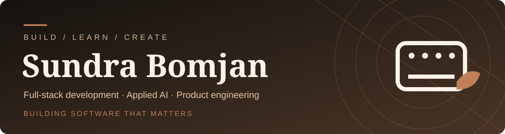
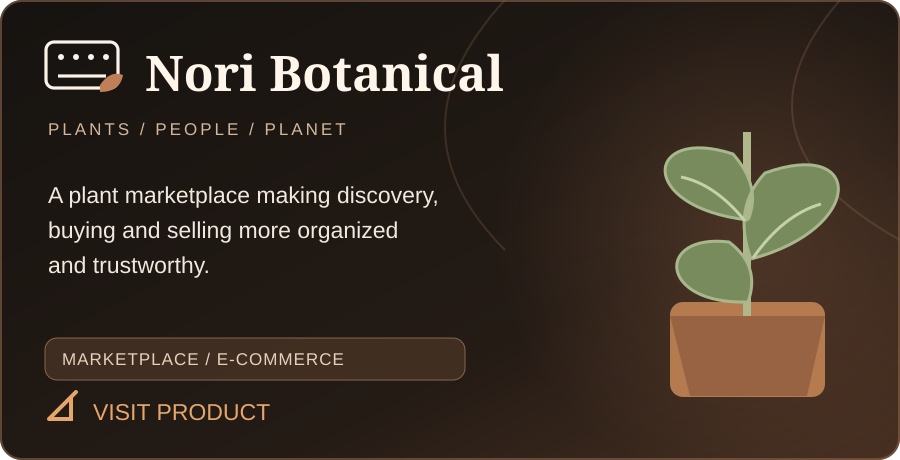
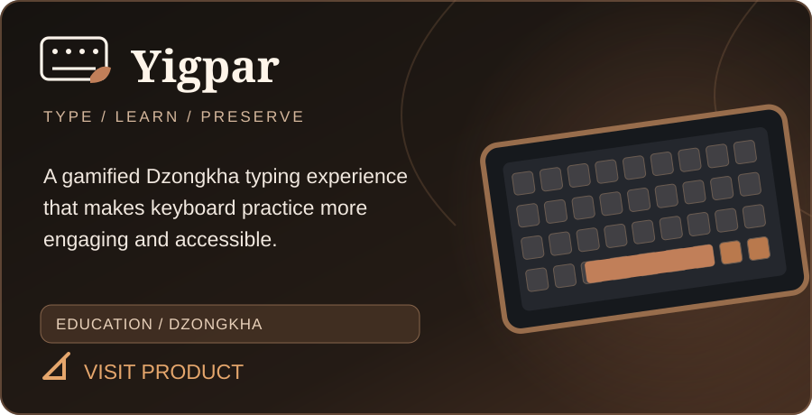
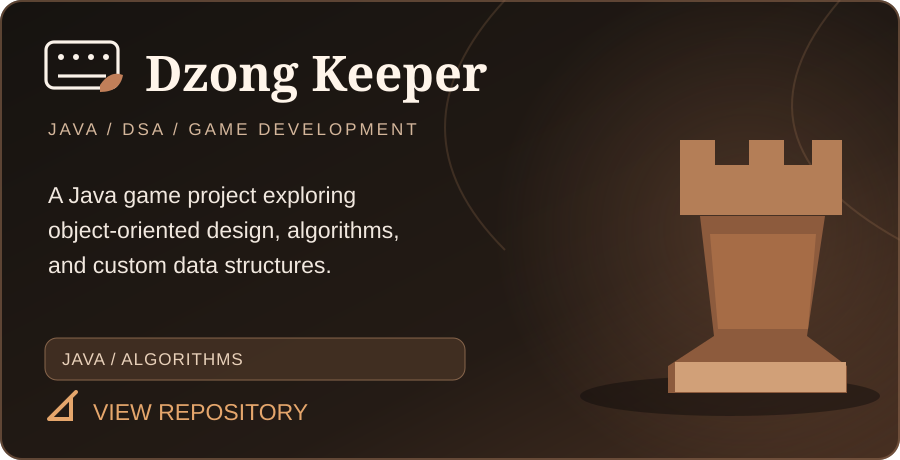
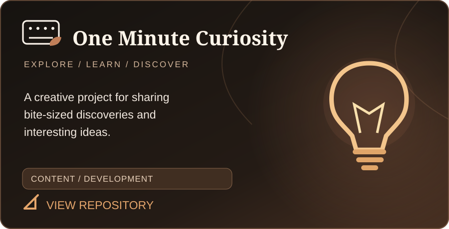
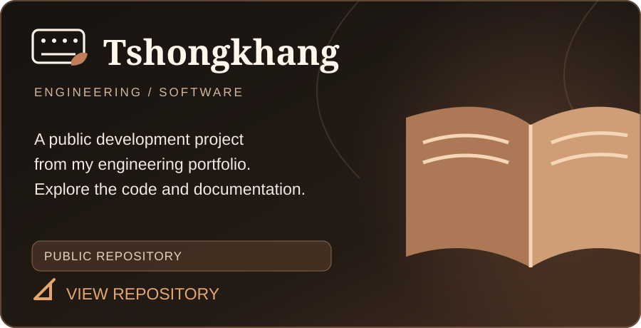

  

  
<strong>Software developer · CTO at <a href="https://noribotanical.com">Nori Botanical</a> · Computer Science student</strong>

  
Building practical products with full-stack engineering, applied AI, and a focus on reliable software.

  
<a href="https://github.com/Bomjan">GitHub</a> &nbsp; · &nbsp; <a href="https://linkedin.com/in/sundrabomjan">LinkedIn</a> &nbsp; · &nbsp; <a href="mailto:sundrabomjan@gmail.com">Email</a>

---

## Products I'm Building

REAL PRODUCTS &nbsp; / &nbsp; PRIVATE SOURCE CODE &nbsp; / &nbsp; REAL IMPACT

Products I'm building with my teams. The code is private; the product links are public.

<table width="100%"><tr><td width="50%" valign="top"></td><td width="50%" valign="top"></td></tr></table>

<strong>Nori Botanical:</strong> Plant marketplace and product engineering. &nbsp; <strong>Yigpar:</strong> Dzongkha typing game; second place at the Youth Tech-novation Hackathon (Level 2).

---

## Open-Source & Engineering Projects

LEARNING &nbsp; / &nbsp; BUILDING &nbsp; / &nbsp; SHARING

Selected public repositories that demonstrate my engineering work.

<table width="100%">
<tr>
<td width="50%" valign="top"></td>
<td width="50%" valign="top"></td>
</tr>
<tr>
<td width="50%" valign="top"></td>
<td width="50%" valign="middle"><blockquote><strong>Engineering in public</strong>
These repositories document my experiments, problem-solving, and ongoing growth as a developer.

<a href="https://github.com/Bomjan?tab=repositories">Explore all repositories</a>
</blockquote></td>
</tr>
</table>

---

## Tech Stack

<table width="100%"><tr>
<td align="center"><strong>Languages</strong>

</td>
<td align="center"><strong>Frontend & Backend</strong>

</td>
<td align="center"><strong>Databases & Tools</strong>

</td>
</tr></table>

---

## Now Building

<!--NOW_BUILDING:START-->
<table align="center" width="100%">
<tr>
<td align="center" width="33%">

Last activity: 2026-10-27

</td>
<td align="center" width="33%">

Last activity: 2026-10-27

</td>
<td align="center" width="33%">

Last activity: 2026-10-27

</td>
</tr>
</table>
<!--NOW_BUILDING:END-->

---

## GitHub Analytics

  
  

---

## Let's Connect

