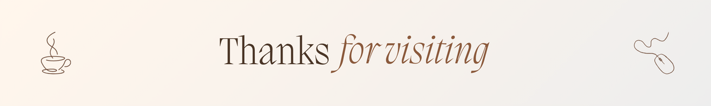

### Sundra Bomjan
**Software Developer · CTO, Nori Botanical · Bhutan**

Building useful software through full-stack development, applied AI, and continuous learning.

[GitHub](https://github.com/Bomjan) · [LinkedIn](https://linkedin.com/in/sundrabomjan) · [Email](mailto:sundrabomjan@gmail.com)

---

## Products I'm Building

**REAL PRODUCTS · PRIVATE SOURCE CODE**

<table width="100%"><tr><td width="50%" valign="top" align="left"><h3><a href="https://noribotanical.com">Nori Botanical</a></h3>PRIVATE PRODUCT
Bhutan-focused plant marketplace. CTO and product engineering.
<a href="https://noribotanical.com">Visit product</a></td><td width="50%" valign="top" align="left"><h3><a href="https://yigpar-game.onrender.com">Yigpar</a></h3>PRIVATE PRODUCT
Dzongkha typing game. Second place at the Youth Tech-novation Hackathon (Level 2).
<a href="https://yigpar-game.onrender.com">Visit product</a></td></tr></table>

---

## Open-Source & Engineering Projects

**LEARNING · BUILDING · SHARING**

<table width="100%"><tr><td width="50%" valign="top" align="left"><h3><a href="https://github.com/Bomjan/dzong-keeper-game">Dzong Keeper</a></h3>PUBLIC REPOSITORY
Java game development, algorithms, data structures and OOP.
<a href="https://github.com/Bomjan/dzong-keeper-game">View code</a></td><td width="50%" valign="top" align="left"><h3><a href="https://github.com/Bomjan/one-minute-curiosity">One Minute Curiosity</a></h3>PUBLIC REPOSITORY
Exploring and sharing interesting ideas in bite-sized formats.
<a href="https://github.com/Bomjan/one-minute-curiosity">View code</a></td></tr><tr><td width="50%" valign="top" align="left"><h3><a href="https://github.com/Bomjan/tshongkhang">Tshongkhang</a></h3>PUBLIC REPOSITORY
A public software development project.
<a href="https://github.com/Bomjan/tshongkhang">View code</a></td><td width="50%"></td></tr></table>

---

## Tech Stack

<table align="center" width="100%">
<tr>
<td align="center" width="25%">

**Languages**

</td>
<td align="center" width="25%">

**Web**

</td>
<td align="center" width="25%">

**Tools**

</td>
<td align="center" width="25%">

**Systems**

</td>
</tr>
</table>

---

## Now Building

<!--NOW_BUILDING:START-->
<table align="center" width="100%">
<tr>
<td align="center" width="33%">

Last activity: 2026-10-23

</td>
<td align="center" width="33%">

Last activity: 2026-10-23

</td>
<td align="center" width="33%">

Last activity: 2026-10-12

</td>
</tr>
</table>
<!--NOW_BUILDING:END-->

---

## GitHub Analytics

  
  

---

## Let's Connect

<table align="center" width="100%">
<tr>
<td align="center" width="33%">

</td>
<td align="center" width="33%">

</td>
<td align="center" width="33%">

</td>
</tr>
</table>

---

### Contribution Snake

  <picture>
    <source media="(prefers-color-scheme: dark)" srcset="./assets/github-snake-dark.svg" />
    
  </picture>

  

  

